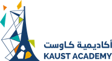
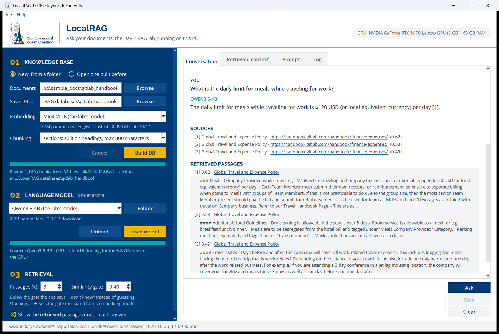

<p align="center"></p>

# LocalRAG: ask your documents

The KAUST Academy **Day 2 RAG lab** as a Windows program. Pick a folder of documents (or a database you built before), choose an embedding model and a language model (Qwen3.5-4B by default), and ask questions that are answered from your documents, with citations. Every step is on screen and in a log: the passages the database returned and their similarity, the exact prompt the model read, the timings.



## Download

| Download | For | Size |
|---|---|---|
| [LocalRAG-1.0.0-win64-cpu.zip](https://github.com/KAUST-Academy/LocalRAG/releases/latest/download/LocalRAG-1.0.0-win64-cpu.zip) | any 64-bit Windows 10 or 11 PC | 0.39 GB |
| [LocalRAG-1.0.0-win64-cuda.zip](https://github.com/KAUST-Academy/LocalRAG/releases/latest/download/LocalRAG-1.0.0-win64-cuda.zip) | PCs with an NVIDIA GPU (GTX 16 / RTX 20 series or newer); also runs without one | 1.89 GB |
| [Python_to_EXE_Guide.pdf](Python_to_EXE_Guide.pdf) | how this program was made: turning a Python lab into a Windows `.exe` | 3 MB |

Unzip the whole folder, then double-click `LocalRAG.exe`. If Windows says *Windows protected your PC*, click **More info**, then **Run anyway**: the program is not code-signed. Language models download the first time you load them (Qwen3.5-4B: 9.3 GB) and load from your PC after that. `README.txt` in the zip lists what your PC needs.

## What it does

- **01 Knowledge base:** build a ChromaDB vector database from a folder of `.pdf .docx .txt .md .csv .html` files, or open one you built before; it remembers its embedding model.
- **Five embedding models:** MiniLM-L6 (the lab's), BGE small and base, multilingual E5 small, Qwen3-Embedding 0.6B, each with a similarity gate measured on the lab's questions.
- **02 Language models, one at a time:** Qwen3.5-4B (the lab's), Qwen3.5-0.8B, 2B and 9B, Qwen3-4B-Instruct, Phi-4-mini, SmolLM3-3B, or any Hugging Face model id or model folder. An NVIDIA GPU is used when the model fits in its memory; otherwise the CPU.
- **03 Retrieval:** the number of passages and the similarity gate; below the gate the program answers "I don't have that information".
- **Shows its work:** *Retrieved context*, *Prompt* and *Log* tabs, and a Markdown and a JSONL log of every session in `%LOCALAPPDATA%\LocalRAG\sessions`.
- **Sample documents:** the lab's 38 GitLab handbook pages.

## Build it yourself

On Windows 10 or 11 with Python 3.14 from python.org (it installs the `py` launcher):

```powershell
cd app
.\build.ps1              # CUDA build -> dist\LocalRAG-1.0.0-win64-cuda.zip
.\build.ps1 -Torch cpu   # CPU build  -> dist\LocalRAG-1.0.0-win64-cpu.zip
```

The script creates a virtual environment from `requirements.txt`, runs PyInstaller on `LocalRAG.spec`, tests the frozen program (`LocalRAG.exe --selftest`) and zips it. To run from source, use `python local_rag.py` in that environment. [The guide](Python_to_EXE_Guide.pdf) explains every step and the problems met on the way.

| Path | What it is |
|---|---|
| `app/local_rag.py` | the window, the self-test and logging; the entry point |
| `app/rag_engine.py` | the lab's pipeline: read, clean, chunk, embed, ChromaDB, gate, prompt, models |
| `app/session_log.py` | the Markdown and JSONL session logs |
| `app/LocalRAG.spec`, `app/build.ps1` | the PyInstaller recipe and the build script |
| `app/tools/` | `fetch_sample_docs.py` (the lab's pages), `calibrate.py` (the similarity gates) |
| `guide/` | the guide's source (`guide.html`) and `make_pdf.ps1`, which prints it to PDF with Edge |

## License

LocalRAG is free software under the [GNU General Public License v3.0](LICENSE). The sample documents are from the [GitLab Handbook](https://handbook.gitlab.com), © GitLab Inc., CC BY-SA 4.0. Raleway and Open Sans are under the SIL Open Font License. The Windows builds include third-party packages (PyTorch, Transformers, ChromaDB and others) and the all-MiniLM-L6-v2 model under their own licenses. The KAUST Academy name and logo belong to KAUST Academy.
